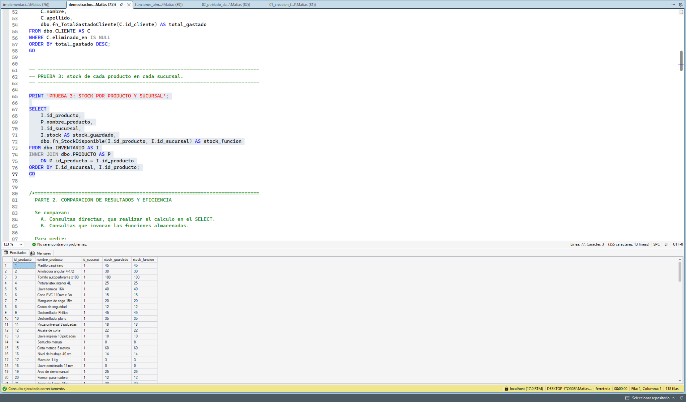

# Etapa V - Procedimientos y Funciones Almacenadas: Operaciones CRUD (Cliente)

## 1. Descripción
Implementación de los tres procedimientos almacenados para la gestión básica de la tabla `CLIENTE` (Alta, Modificación y Baja Lógica) correspondientes a la Etapa V.

---

## 2. Detalle de los Procedimientos

### 2.1. Inserción (`sp_InsertarCliente`)
Recibe los datos del nuevo cliente (`nombre`, `apellido`, `dni`, `correo`, `id_direccion`) y ejecuta la sentencia `INSERT INTO CLIENTE`.

### 2.2. Modificación (`sp_ModificarCliente`)
Recibe el `id_cliente` junto a los datos actualizados. Comprueba que el cliente exista en la base de datos antes de realizar el `UPDATE`.

### 2.3. Eliminación (`sp_EliminarCliente`)
Recibe el `id_cliente` y realiza una **baja lógica** actualizando el campo `eliminado_en = GETDATE()`. Esto permite desactivar el registro sin romper la integridad referencial con las ventas asociadas.

---

## 3. Ejemplo de Ejecución y Demostración (T-SQL)

La demostración está en
[`02_demostracion_procedimientos.sql`](../../sql/tecnico/procedimientos/02_demostracion_procedimientos.sql).
Las pruebas CRUD generan un DNI y un correo únicos, insertan un cliente
temporal y conservan el `id_cliente` devuelto por la consulta de
verificación. Ese mismo identificador se usa para la modificación y la
baja lógica. Las tres operaciones se ejecutan dentro de una transacción
que termina con `ROLLBACK`, por lo que no modifican clientes reales ni
dejan datos temporales.

También compara dos formas de insertar un lote de cinco clientes:

1. Una sentencia `INSERT ... SELECT` directa.
2. Cinco ejecuciones de `sp_InsertarCliente`.

Los valores de prueba se generan para evitar colisiones con DNI y correos
existentes. La demostración mide ambas alternativas con
`SET STATISTICS TIME ON/OFF`, muestra cuántas filas quedaron insertadas
por cada alternativa y finalmente ejecuta `ROLLBACK`. Una consulta
posterior comprueba que no queden filas del lote.

El tiempo medido depende del contexto, el equipo y la carga del servidor,
por lo que una ejecución aislada no demuestra que una alternativa sea
siempre más rápida. Además de su rendimiento, el procedimiento permite
centralizar y reutilizar la lógica de inserción.

**Evidencia final de la comparación:** la captura existente
[`03_comparacion_inserciones.png`](../../sql/tecnico/procedimientos/evidencias/03_comparacion_inserciones.png)
muestra ambas mediciones en la pestaña **Mensajes**, los conteos de cinco
filas para cada alternativa y cero filas restantes después del
`ROLLBACK`. Los detalles están en
[`README de evidencias`](../../sql/tecnico/procedimientos/evidencias/README.md).

## 4. Funciones almacenadas

Además de los procedimientos almacenados destinados a realizar
operaciones de alta, modificación y baja lógica de clientes, se
desarrollaron tres funciones almacenadas para resolver consultas y
cálculos frecuentes del sistema de ferretería.

Las funciones reciben parámetros de entrada y devuelven un resultado que
puede utilizarse dentro de consultas `SELECT`. De esta manera, se
centraliza la lógica de determinados cálculos y se facilita su
reutilización en distintas consultas.

### 4.1. `fn_ImporteDetalleVenta`

Esta función calcula el importe correspondiente a un detalle de venta.
Para obtener el resultado, considera la cantidad de unidades vendidas,
el precio unitario registrado al momento de la operación y el descuento
aplicado a la venta.

Se utiliza el precio histórico del detalle para conservar el importe
original de la operación, aunque el precio actual del producto cambie
posteriormente. El resultado permite conocer cuánto representa
económicamente cada renglón de una venta luego de aplicar el descuento
correspondiente.

**Evidencia de funcionamiento:** en la siguiente captura se observa el
resultado de ejecutar la función para distintos detalles de venta, junto
con los datos utilizados para realizar el cálculo.

### 4.2. `fn_TotalGastadoCliente`

Esta función obtiene el importe total gastado por un cliente a partir de
las ventas asociadas a su identificador. Recibe como parámetro el
`id_cliente` y devuelve la suma de los importes correspondientes a sus
ventas.

Su utilidad consiste en consultar de manera sencilla el total de compras
acumuladas de cada cliente. El resultado puede incorporarse a consultas
que permitan analizar el historial de compras o conocer el volumen de
operaciones asociado a cada persona.

**Evidencia de funcionamiento:** la captura muestra los clientes
consultados y el total gastado calculado por la función para cada uno.

### 4.3. `fn_StockDisponible`

Esta función permite consultar la cantidad de unidades disponibles de un
producto en una sucursal específica. Para ello, recibe dos parámetros:
el identificador del producto (`id_producto`) y el identificador de la
sucursal (`id_sucursal`).

De esta manera, se puede consultar el inventario de una sucursal sin
confundirlo con el stock que el mismo producto pueda tener en otras
sucursales. Esto resulta útil para las tareas de control y consulta de
existencias.

**Evidencia de funcionamiento:** en la captura se comparan los valores
obtenidos directamente desde la tabla `INVENTARIO` (`stock_guardado`)
con los devueltos por la función (`stock_funcion`). La coincidencia de
ambos valores permite comprobar que la función recupera correctamente el
stock registrado para cada producto y sucursal.

### 4.4. Verificación general

Las tres funciones se probaron mediante consultas en SQL Server
Management Studio. En las capturas se observan los resultados devueltos
y el mensaje de ejecución correcta.

Estas pruebas permiten verificar que las funciones reciben los
parámetros correspondientes y devuelven los valores esperados para los
datos cargados en la base de datos `ProyectoFerreteria`.
